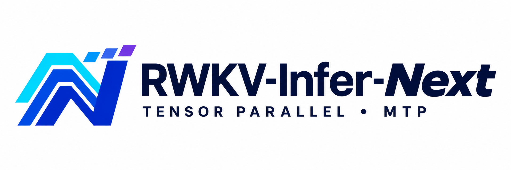

<p align="center"></p>

# RWKV-Infer-Next

An inference server for RWKV-7 text models, built for multi-GPU throughput: tensor parallelism, continuous
batching on CUDA graphs, int6 weights and MTP speculative decoding, behind an OpenAI-compatible API with a WebUI.

- **Models**: Hugging Face style model folders (`model.safetensors.index.json` + shards, `config.json`,
  `chat_template.jinja`), a single `.safetensors`, or a plain RWKV-7 `.pth`. Loaded lazily, one tensor at a time.
- **Chat templates**: the model's own `chat_template.jinja` (or `tokenizer_config.json`'s `chat_template`), rendered byte-for-byte like transformers'
  `apply_chat_template` (checked against transformers itself). A built-in RWKV-7 G1 template is used for checkpoints
  without one.
- **Thinking**: per request (`thinking`, `chat_template_kwargs.thinking` / `enable_thinking`, `reasoning_effort`) or
  by default; the reasoning is returned in `reasoning_content` (or inline as `<think>…</think>`).
- **Tool calls**: OpenAI `tools` / `tool_choice`, `tool_calls` in responses (streamed too), `role: tool` results, parallel calls.
- **Tensor parallel**: time-mix split by heads, channel-mix by FFN columns, two all-reduces per layer.
- **Continuous batching**: a slot pool of recurrent states, chunked prefill interleaved with decoding, one CUDA graph replay per decode step.
- **Quantisation**: int6 (default), int8 or bf16, weight-only. Quantised block by block on the GPU, so the bf16 model never has to fit.
  Under int6 / int8 the head is int8 and the embedding table per-row int8; the LoRA projections stay bf16.
- **MTP speculative decoding**: optional sidecar; the whole speculative step is one CUDA graph per GPU. The output distribution is unchanged.
- **WebUI**: chat (conversations, search, export/import, edit & resend, regenerate, collapsible reasoning, presets) and a
  settings / status page that edits `.env` and restarts the engine.
- **No rwkvfla**: every kernel (WKV recurrence, int6 / int8 GEMM) is in `rwkv_next/kernels/` (Triton, standard `tl.*` only).

## Quick start

```bash
pip install -r requirements.txt          # torch (CUDA), triton, fastapi, uvicorn, jinja2, safetensors, huggingface_hub

# one command: download the model from Hugging Face (once), fetch its MTP sidecar, serve on :8000
python -m rwkv_next --model RWKV/RWKV7-G1l-2.9B-20261031 --tp 1                    # one GPU (5.1 GB)
python -m rwkv_next --model RWKV/RWKV7-G1l-7.2B-20261031 --tp 1                    # one 16 GB GPU (9.4 GB)
python -m rwkv_next --model RWKV/RWKV7-G1l-13.3B-20261031 --tp 1 --max-batch 16    # one 16 GB GPU (14.6 GB)
python -m rwkv_next --model RWKV/RWKV7-G1l-13.3B-20261031 --tp 2                   # two GPUs (~9.5 GB each)

# WebUI: http://localhost:8000/ui     API: http://localhost:8000/v1/chat/completions
python -m rwkv_next --stop               # stop the server started from this directory (PID file)
```

| Option | Meaning |
|---|---|
| `--model` | a Hugging Face repository id (`org/name`, optionally `@revision`) or a local folder / file |
| `--tp`, `--devices` | the number of GPUs, and which ones |
| `--quant` | `int6` (default), `int8`, `bf16` |
| `--mtp` | `auto` (default), `off`, or a path / repository |
| `--mtp-force` | use a sidecar trained for another model: the closest one of the same width (for new releases of a 7B / 13B model without their own sidecar) |
| `--host`, `--port`, `--max-batch` | |

The options are shortcuts for `RWKV_*` settings. Everything can also live in `.env`: `cp .env.example .env`, or the WebUI's Settings page.
- **Models** are downloaded once into the Hugging Face cache (`HF_HOME`). `HF_TOKEN` is used for gated repositories, and `HF_HUB_OFFLINE=1` uses only the cache.
- **MTP sidecars** come from the model folder (`mtp/`) or, when it has none, from `RWKV_MTP_REPO` (default [OpenMOSE/RWKV7-MTP-Exp](https://huggingface.co/OpenMOSE/RWKV7-MTP-Exp)). Only the folder for the loaded model is downloaded. Without a matching sidecar, the engine runs without MTP.

```bash
curl http://localhost:8000/v1/chat/completions -H 'Content-Type: application/json' -d '{
  "messages": [{"role": "user", "content": "What is the weather in Tokyo?"}],
  "tools": [{"type": "function", "function": {"name": "get_weather",
             "parameters": {"type": "object", "properties": {"city": {"type": "string"}}, "required": ["city"]}}}],
  "thinking": false
}'
```

## API

| Endpoint | |
|---|---|
| `POST /v1/chat/completions` | messages (system / user / assistant with `tool_calls` / tool), `tools`, `tool_choice` (`auto`, `none`, a named function), `stream`, `temperature`, `top_p`, `top_k`, `min_p`, `presence_penalty`, `frequency_penalty`, `penalty_decay`, `max_tokens`, `stop`, thinking switches, `continue_final_message` (write on from the end of a final assistant message) |
| `POST /v1/completions` | raw prompt completion (no template, no default stop) |
| `GET /v1/models` | the loaded model |
| `GET /api/status` | engine state, speed, slots, chat template, MTP |
| `GET /api/settings` | the settings schema and values (secrets blanked) |
| `PUT /api/settings`, `POST /api/engine/restart`, `POST /api/engine/stop`, `GET /api/files` | change settings / control the engine / file picker (localhost only unless `RWKV_ALLOW_REMOTE_SETTINGS=1`) |
| `POST /api/tokenize` | token count of a text or of rendered `messages` (`return_prompt: true` also returns the prompt) |

With `RWKV_API_KEY` set, `/v1/*`, `/api/tokenize` and `GET /api/settings` need `Authorization: Bearer <key>` (the WebUI asks
for the key once and keeps it in the browser). `/api/status` stays open for health checks. Engine-side failures of a
non-streaming request return HTTP 503; a streamed request ends with an `error` event.

Responses carry `rwkv: {ttft_s, tok_s, thinking}` next to `usage`.

**Thinking** is on when the request asks for it in any of these forms, else `RWKV_THINKING_DEFAULT` applies:
`"thinking": true`, `"chat_template_kwargs": {"thinking": true}` or `{"enable_thinking": true}`, `"reasoning_effort": "low|medium|high"`
(`"none"` turns it off). With the G1 template the assistant turn starts with `Assistant: <think` (on) or
`Assistant: <think></think>\n` (off). Reasoning from earlier assistant turns is not sent back to the model.

**Tool calls**: the template lists the tools and asks for a fenced ```` ```json {"name": ..., "arguments": {...}} ``` ```` block;
the parser also accepts `<tool_call>{...}</tool_call>` and a bare JSON object. Only functions that were offered become
`tool_calls` (arguments as a JSON string, `finish_reason: "tool_calls"`); anything else stays content. While streaming, a
block is held back until it is complete, so it never leaks into `content`.

## Settings

Every setting is `RWKV_<NAME>` in `.env` (or the process environment, which wins and shows as locked in the UI). The WebUI
writes `.env`; settings marked *restart* apply at the next engine restart (the HTTP server stays up), `HOST` / `PORT` when the
server process is restarted, the others immediately.

| Group | Keys |
|---|---|
| Model | `MODEL_PATH`, `MODEL_NAME`, `QUANT` (int6 / int8 / bf16), `INT6_KEEP_INT8` (att / ffn), `QUANT_GROUP_K` |
| Parallelism | `TP`, `DEVICES` |
| Engine | `MAX_BATCH`, `GRAPH_BATCH_SIZES`, `COMPILE`, `PREFILL_CHUNK`, `PREFILL_CHUNK_BUSY`, `MAX_PROMPT_TOKENS` |
| MTP | `MTP_PATH` (`auto` / path / HF repo / empty or `off`), `MTP_REPO` (sidecar repository for `auto`, default `OpenMOSE/RWKV7-MTP-Exp`), `MTP_FORCE` (use the closest sidecar of another model), `MTP_K` (drafts by batch size, e.g. `4:3,16:2,0:0`), `MTP_DRAFT_VOCAB` |
| Chat | `CHAT_TEMPLATE` (`auto` / `builtin` / path), `THINKING_DEFAULT`, `REASONING_FORMAT` (separate / inline), `SYSTEM_PROMPT`, `STOP` |
| Sampling defaults | `TEMPERATURE`, `TOP_P`, `TOP_K`, `MIN_P`, `PRESENCE_PENALTY`, `FREQUENCY_PENALTY`, `PENALTY_DECAY`, `MAX_TOKENS` |
| Server | `HOST`, `PORT`, `API_KEY`, `ALLOW_REMOTE_SETTINGS` |

## MTP sidecars

Full specification (drafter architecture, sidecar format, runtime protocol, measurements): [docs/mtp.md](docs/mtp.md).

An MTP sidecar is a small drafter (one gated sliding-window attention block: ~250M parameters for a 4096-wide model,
~100M for the 2560-wide 2.9B) trained for ONE base model.

**Published sidecars:** [OpenMOSE/RWKV7-MTP-Exp](https://huggingface.co/OpenMOSE/RWKV7-MTP-Exp) has sidecars, each
trained for 1.0B tokens, for these base models. They are picked automatically with `MTP_PATH=auto`.

| Base model | One 16 GB GPU, int6: no MTP → MTP | Two GPUs (TP2): no MTP → MTP |
|---|---|---|
| `RWKV/RWKV7-G1l-2.9B-20261031` | 240 → 436–443 tok/s (1.8–1.9×) | 205 → 382–403 tok/s (one GPU is faster) |
| `RWKV/RWKV7-G1l-7.2B-20261031` | 119 → 243–249 tok/s (2.0–2.1×) | 141 → 269–275 tok/s (1.9–2.0×) |
| `RWKV/RWKV7-G1l-13.3B-20261031` | 64 → 143 tok/s (2.2×, `--max-batch 16`) | 78 → 162 tok/s (2.1×) |

Single stream, mean of 6 chat prompts, greedy and sampled ([docs/mtp.md §6](docs/mtp.md#6-measured)). A sidecar repository is one folder per base model plus an `index.json`
(`rwkv_next/hub.py`).

**New models without their own sidecar:** `--mtp-force` / `RWKV_MTP_FORCE=1` picks the sidecar of the same width whose base model has the closest layer count. A layer-count mismatch only warns, and the tapped layers move to the same relative depth. A forced sidecar never changes the output, only the speed, and the speed-up depends on how close the new model is to the one the sidecar was trained on. A poorly matching sidecar can be slower than no MTP. Measured: the 7.2B sidecar forced onto the 13.3B model gave 66 tok/s against 78 tok/s without MTP.

**Packaging your own:** ship it next to the model:

```bash
python tools/export_mtp.py --sidecar mtp-....pt --model /path/to/RWKV7-G1l-7.2B-20261031
# -> /path/to/RWKV7-G1l-7.2B-20261031/mtp/mtp.safetensors + mtp.json
```

With `RWKV_MTP_PATH=auto` (the default) the engine uses `mtp/` (or a `*.mtp.safetensors` / `*.mtp.pt`) found in the model
folder. The exported meta records the base model's layer count, and a sidecar made for another model is refused
(a 7B sidecar would otherwise load on a 13B of the same width and only produce useless drafts).

## Architecture

Details: [docs/architecture.md](docs/architecture.md)

```
front process (HTTP, WebUI, tokenizer, chat template, output parser; no CUDA)
  │  multiprocessing queues (requests / token batches)
rank 0 (scheduler, sampler, MTP drafter, its model shard)
  │  shared-memory command channel: every model call of rank 0 is replayed by the other ranks, in order
ranks 1..N-1 (model shards)
  └─ NCCL all-reduce (2 per layer, inside the CUDA graphs)
```

- State pool layout: decoding rows at `[0, nd)`, rows in prefill take slots from the top, so graph padding only touches free slots.
- A speculative step is one CUDA graph per rank: draft → NCCL broadcast of the drafts → verify (compiled) → in-graph
  sampling at every position → broadcast of the accepted counts → rollback (WKV replay of the kept steps) → drafter commit.
  Workers never sync with the host; rank 0 once per step.
- Ranks stay in lockstep (rank 0 syncs every step to sample). Letting one rank run many steps ahead through a mix of
  graphed and eager collectives was seen to hang NCCL's shared-memory transport.

## Measured (2 PCIe GPUs without P2P, G1 7.2B, 2026-11-07)

| Decode tok/s | B=1 | B=4 | B=16 | B=32 | B=64 |
|---|---|---|---|---|---|
| int6, TP1 | 114 | 407 | 1319 | 2155 | — |
| int6, TP2 | **142** | **500** | **1453** | 2103 | **2608** |
| bf16, TP2 | 86 | 292 | 979 | 1652 | 2266 |

- int6 + MTP, single stream: see [MTP sidecars](#mtp-sidecars) (G1l 7.2B with the 1.0B-token sidecar: 269–275 tok/s on TP2, plain ~141).
- int6 quality vs bf16 on G1 7.2B: ΔCE +0.008, top-1 agreement 94.6% (int8: +0.001, 98.0%). `INT6_KEEP_INT8=att`: +0.003.
- All-reduce over host shared memory costs 24–53 µs here; with NVLink / P2P, TP scales much better.
- Prefill is compute bound: ~4.8K tok/s per GPU on the 7B.

## Tests

```bash
python tools/test_wkv7.py                                   # WKV kernel vs an fp64 reference (plain, varlen, compiled, rollback replay)
python tools/test_template.py --model <model folder>         # template == transformers (text + token ids), output parser (streamed)
python tools/test_tp.py --ckpt <model> --check               # graphs vs eager, TP2 vs TP1 (+ an external reference with RWKV_REF_HARNESS)
python tools/test_engine.py --ckpt <model> [--mtp <sidecar> --chat]   # scheduler: batched vs solo, MTP vs plain
python tools/test_quality.py --ckpt <model> --windows <npz>  # quantisation CE / KL / top-1 vs bf16
python tools/test_client.py                                  # virtual OpenAI client against a running server
```

`tools/test_client.py` reports model-behaviour checks (e.g. "follows the system prompt") as WARN, separately from engine failures.

## Notes

- NCCL over shared memory needs `NCCL_CUMEM_ENABLE=0` (set automatically), otherwise the first all-reduce hangs (NCCL 2.30).
- Only plain RWKV-7 checkpoints (`blocks.*`, `emb`, `head`, optionally prefixed `rwkv7.` / `rwkv.` / `model.` / `llm.`) are supported.
- The LoRA projections stay bf16 under int6 / int8: int8 LoRA measured ΔCE +0.024 (the decay / gate LoRAs are sensitive).
