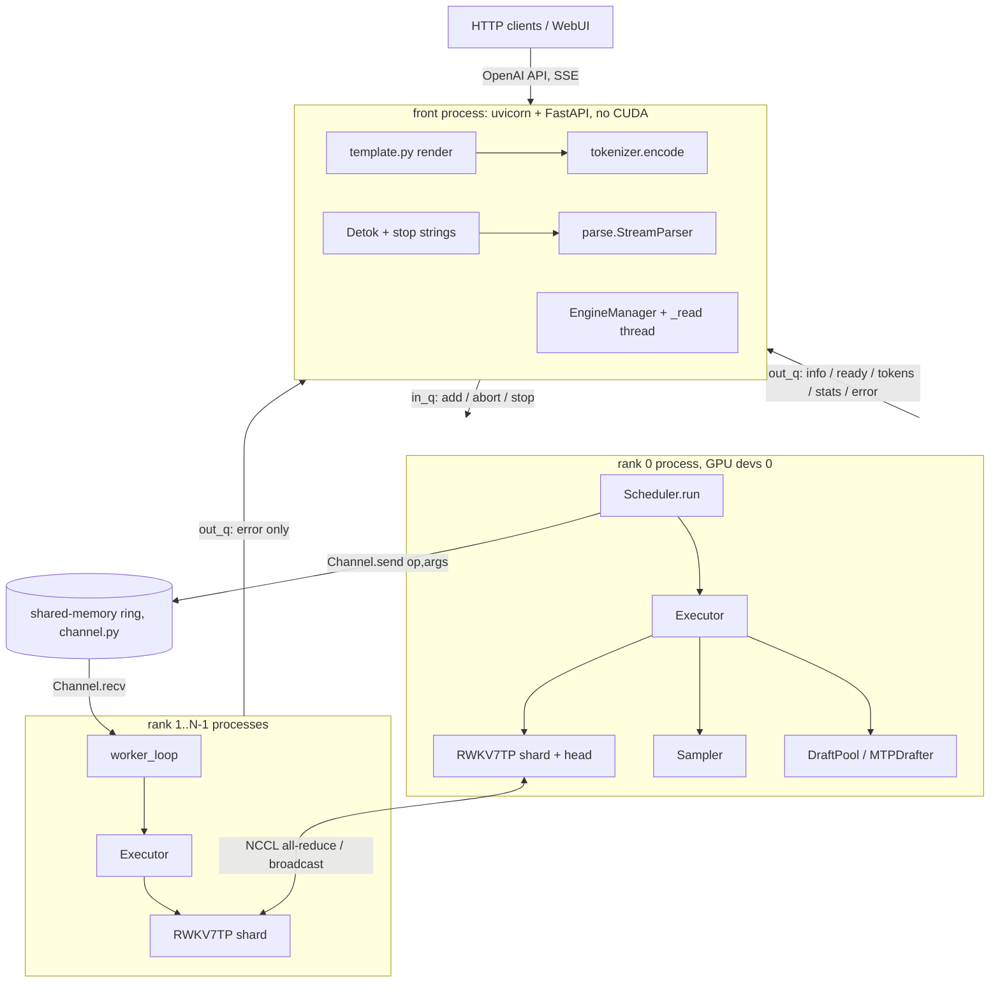
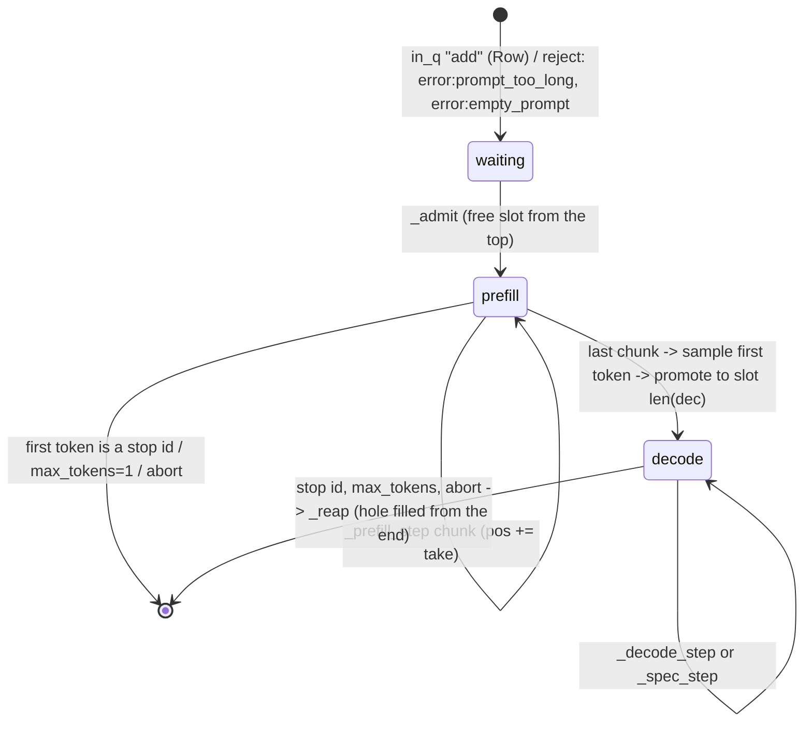

# RWKV-Infer-Next: architecture

This document is for engineers who maintain or port the engine. It describes what the code does as of
2026-11-08. Each mechanism is cited as `file:function` (paths relative to `rwkv_next/` unless they start with
`tools/` or `webui/`). Where the code and `README.md` disagree, this document follows the code, and the
difference is listed in [Notes / open issues](#9-notes--open-issues).

Contents

1. [Process topology](#1-process-topology)
2. [Model and tensor parallelism](#2-model-and-tensor-parallelism-modelpy)
3. [Kernels](#3-kernels-kernels)
4. [Scheduler](#4-scheduler-enginepy)
5. [MTP speculative decoding (inference side)](#5-mtp-speculative-decoding-inference-side)
6. [HTTP / API layer](#6-http--api-layer)
7. [Configuration reference](#7-configuration-reference)
8. [Testing tools](#8-testing-tools)
9. [Notes / open issues](#9-notes--open-issues)

Module map

| Module | Role | Runs in |
|---|---|---|
| `__main__.py` | `python -m rwkv_next` calls `server.main` | front |
| `server.py` | FastAPI app, `EngineManager` (spawns and monitors the rank processes), stop strings, SSE | front |
| `config.py` | settings schema, `.env` and environment precedence, `.env` writer | front |
| `template.py` | Jinja chat template, rendered the way transformers renders it | front |
| `parse.py` | splits model output into reasoning, content and tool calls (streaming and final) | front |
| `tokenizer.py`, `chat.py` | RWKV trie tokenizer; incremental UTF-8-safe detokenizer `Detok` | front |
| `engine.py` | `rank_main` process entry, `Executor` (model calls), `Scheduler` (rank 0), `worker_loop` | every rank |
| `channel.py` | shared-memory command ring, rank 0 to workers | every rank |
| `tp.py` | NCCL process group wrapper `TP` | every rank |
| `model.py` | `RWKV7TP`: sharded and quantised RWKV-7, slot pool, decode/prefill/verify, CUDA graphs | every rank |
| `weights.py` | lazy checkpoint access (`.pth`, `.safetensors`, HF folder) | every rank |
| `sampler.py` | batched sampler with penalty table (`Sampler`) | rank 0 |
| `spec.py` | `SpecGraphs`: one CUDA graph per speculative step; `sample_graph` | every rank |
| `drafter.py` | `DraftPool`: per-slot MTP drafter state, sidecar discovery and guard | rank 0 |
| `mtp.py` | `MTPDrafter` math (gated sliding-window attention block), sidecar loading, K rules | rank 0 |
| `kernels/wkv7.py` | WKV-7 recurrence (Triton) | every rank |
| `kernels/int6_gemm.py`, `kernels/int8_gemm.py` | weight-only W6A16 / W8A16 GEMM (Triton) | every rank |
| `kernels/autotune_cache.py` | saves Triton autotune choices to disk and restores them | every rank |

---

## 1. Process topology



### 1.1 Front process

`server.py` builds one `Settings`, one `RWKVTokenizer` and one `EngineManager` at import time. The front never
imports torch or CUDA. `EngineManager.start` uses the `spawn` multiprocessing context (`mp.get_context("spawn")`)
to start `world = RWKV_TP` processes running `engine.rank_main(rank, world, cfg, chan_name, in_q, out_q, port)`,
all with `daemon=True`. Before that it:

- takes `cfg = settings.engine_view()`, which holds only the keys marked `restart=True`, so the engine sees a
  fixed snapshot;
- refuses to start when `MODEL_PATH` is empty (state `stopped`) or does not exist (state `error`);
- creates the shared-memory `Channel(None, world-1, create=True)` when `world > 1`, picks a free TCP port for the
  NCCL rendezvous (`_free_port`), and creates two `ctx.Queue()`s;
- increments `self.gen` and starts the `_read` thread for that generation.

Queue protocol (`engine.py` module docstring plus `Scheduler.run` and `rank_main`):

| Direction | Message | Producer |
|---|---|---|
| in | `("add", rid, prompt_ids, params)` | `EngineManager.submit` |
| in | `("abort", rid)` | `EngineManager.release(abort=True)` |
| in | `("stop",)` | `EngineManager.stop` (only when state is `ready`) |
| out | `("info", dict)` (model, tp, quant, mtp, layers, n_embd, heads, vocab, graph_sizes, vram_gb) | rank 0, before `run` |
| out | `("ready", {"slots": S})` | `Scheduler.run` start |
| out | `("tokens", [(rid, [ids], finish or None, {})...])` | rank 0, once per scheduler iteration with events |
| out | `("stats", dict)` | rank 0, about once per second |
| out | `("error", traceback_text)` | any rank, `rank_main` except path |

Only rank 0 reads `in_q`. Every rank holds `out_q`, so any rank can report an error.

### 1.2 Rank processes and NCCL

`rank_main` does the following, in this order and identically on every rank:

1. `tp.init(rank, world, port, devs[rank])`: `torch.cuda.set_device`. When `world > 1` it calls
   `os.environ.setdefault("NCCL_CUMEM_ENABLE", "0")` and then
   `dist.init_process_group("nccl", init_method="tcp://127.0.0.1:port", device_id=...)`. The reason for the
   variable is in the `tp.py` docstring: on GPUs without peer access NCCL goes through host shared memory, and
   with cuMem allocations that transport hangs on the first collective (torch 2.14 / NCCL 2.30). `setdefault`
   means an explicit environment value wins. `RWKV_DEVICES` maps ranks to GPU indices; when it is empty, rank r
   uses GPU r.
2. `RWKV7TP.load(...)` builds the rank's shard (§2), then `alloc_slots(MAX_BATCH)`.
3. MTP setup (§5): `drafter.find_sidecar`. On rank 0 only, `DraftPool` is created and `m.tap_layers = pool.taps`
   is set.
4. `m.compile(sizes)` if `COMPILE`, then `m.capture_decode(sizes)`, then (when MTP is on) `SpecGraphs.capture` for
   every (graph size, K) pair. Every rank captures the same list in the same order, because the collectives inside
   the graphs have to pair up.
5. Prefill warm-up: `Executor(m).prefill` for lengths 1, 2, 4, …, 128, 300 and 1000 (fresh), each followed by a
   continuation of `min(n, 3)` tokens, all into slot 0. Slot 0 is reset afterwards. This triggers int6/int8 GEMM
   autotuning for every M bucket at start-up so that the first request does not pay for it. Rank 0 then calls
   `kernels.autotune_cache.save`.
6. Rank 0 builds `Executor(m, Sampler(S, V, dev), pool)`, posts `("info", …)`, and enters `Scheduler.run`. The
   other ranks attach to the channel and enter `worker_loop`.

### 1.3 Command channel and the lockstep rule

The collectives inside every model call pair up across ranks, so each call that rank 0 makes has to be repeated by
every worker in the same order with the same arguments. `Scheduler.call(op, *args)` first sends `(op, args)` over
the channel and then runs `getattr(self.ex, op)(*args)` locally. `worker_loop` is
`op, args = chan.recv(reader); getattr(ex, op)(*args)` until `op == "stop"`. The mirrored ops are the `Executor`
methods `prefill`, `decode`, `move`, `verify`, `rollback` and `spec`.

`channel.Channel` layout (shared memory):

```
[ writer seq (8B, padded to 64B) ][ reader 0 ack seq (64B) ] ... [ reader n-1 ack (64B) ]
[ slot 0: len (8B) + pickle ][ slot 1 ] ... [ slot 63 ]       slots=64, slot_bytes=1 MiB (defaults)
```

- `send`: pickles the object, raises if it exceeds the slot, and spins (`time.sleep(0)`) while any reader is a
  full ring behind (`nxt - min(acks) > slots`). It then writes the slot and publishes the new writer sequence.
- `recv`: spins on the writer sequence, falls back to 0.5 ms sleeps after 20 000 spins and to 5 ms after 200 000,
  so an idle server does not keep a core busy per GPU. It then unpickles and writes its ack.

Lockstep rule (`tp.py` docstring and the README): ranks must not drift many steps apart. A rank that ran many
steps ahead through a mix of graphed and eager collectives was seen to hang the NCCL SHM transport. The engine is
lockstep by construction. Rank 0 synchronises with the host every step, because it reads the sampled tokens with
`.tolist()`. The workers only receive the next command after that, since rank 0 issues it after the sync.

### 1.4 Shutdown, PID file, restart

- Normal stop: `EngineManager.stop` puts `("stop",)` on `in_q` (only if state is `ready`). `Scheduler.run`
  leaves its loop and sends `("stop", ())` on the channel. Workers return from `worker_loop`. Every rank ends in
  `rank_main`'s `finally: os._exit(0)`. `tp.shutdown` does nothing on purpose: `destroy_process_group()` over the
  SHM transport hangs at teardown (NCCL 2.30). The front joins the processes for up to 5 s in total, kills any
  that are still alive, unlinks the channel, increments `gen` (the old `_read` thread exits), fails all open
  streams with `error:engine_restarted`, and sets state `stopped`.
- Restart (`POST /api/engine/restart`, or `PUT /api/settings` with `restart: true` when a restart key changed):
  `EngineManager.restart`, i.e. `stop()`, then `settings.reload()`, then `start()`. The HTTP server and its
  connections stay up.
- PID file: `server.main` writes `os.getpid()` to `RWKV_PID_FILE` (default `./.rwkv_next.pid`) before
  `uvicorn.run`. On exit it calls `engine.stop()` and removes the file if it still holds its own PID.
  `python -m rwkv_next --stop` reads the file, sends SIGTERM and polls `os.kill(pid, 0)` for up to 10 s. It does
  not match process names. The FastAPI `shutdown` hook also calls `engine.stop()`.

### 1.5 Error propagation

```mermaid
sequenceDiagram
  participant Rk as failing rank k
  participant Q as out_q
  participant Rd as front _read thread
  participant S as open streams
  participant O as other ranks
  Rk->>Rk: except BaseException: print "[engine error] rank k: <traceback>" to stderr (flush)
  Rk->>Q: put(("error", tb)); out_q.close(); out_q.join_thread()
  Rk->>Rk: finally os._exit(0)
  Rd->>Rd: state = "error", error = tb
  Rd->>S: _fail_streams: every queue gets ([], "error:engine error: <last line>")
  Rd->>O: kill() every rank that is still alive (it would wait in NCCL forever)
```

- `engine.rank_main` catches `BaseException` from every stage (load, capture, warm-up, scheduler, worker loop).
  The traceback always reaches the console. `out_q.close(); out_q.join_thread()` flushes the queue's feeder thread
  before the process exits; without it, `os._exit` would drop the message.
- `server.EngineManager._read` turns an `error` message into state `error` and calls `_fail_streams`. If a process
  dies without a message (segfault, OOM kill), the `queue.Empty` branch sees `not all(p.is_alive())` while the
  state is `loading`/`ready`. It then sets state `error` with "engine process exited while … (see console)" and
  also calls `_fail_streams`.
- `_fail_streams` clears `self.streams`, posts `([], "error:" + why, {})` to each stream's asyncio queue (through
  `loop.call_soon_threadsafe`), and kills the surviving rank processes.
- Clients see the error as follows. Streaming chat sends a final chunk with `finish_reason: "stop"` followed by
  `data: {"error": {"message": ...}}`. Non-streaming chat returns HTTP 400 with the message.

---

## 2. Model and tensor parallelism (`model.py`)

### 2.1 Weight loading

Before the ranks start, the front (`EngineManager._resolve`, `hub.py`) resolves two things to local paths, so the ranks only ever see local files:
- a repository id in `MODEL_PATH`, downloaded into the Hugging Face cache;
- the MTP sidecar, from the model folder or the sidecar repository.


`weights.open_weights(path)` returns a `LazyWeights` mapping from canonical names to zero-argument loaders. Tensors
are read only when accessed:

| Input | Access |
|---|---|
| folder with `model.safetensors.index.json` | `weight_map` → shard files, `safe_open(...).get_tensor` per key |
| folder without index | every `*.safetensors` whose name does not contain `mtp`; if there are none, the first `*.pth` |
| `*.safetensors` | `safe_open` |
| `*.pth` | `torch.load(mmap=True, weights_only=True)` |

Key prefixes `rwkv7.`, `model.`, `llm.` and `rwkv.` are stripped (`weights._canon`). `RWKV7TP.config_of(sd)`
infers `n_layer` (max `blocks.N` + 1), `vocab_size, n_embd` from `emb.weight`, `n_head, head_size` from
`blocks.0.att.r_k`, and `dim_ffn` from `blocks.0.ffn.key.weight`. `RWKV7TP.__init__` checks that `H % tp == 0`
and `F % tp == 0`.

`RWKV7TP.load` processes one layer at a time. Each tensor is sliced on the CPU (a view of the mmap), moved to the
GPU as bf16 and quantised there (`QW`), followed by `torch.cuda.empty_cache()` per layer. Neither host RAM nor
VRAM ever holds the whole bf16 model.

### 2.2 Shard layout (rank r of tp; Hl = H/tp, Cl = Hl·N, Fl = F/tp; d = widest of the v/w/a LoRA ranks)

| Tensor (per layer) | Shape on a rank | Split | Notes |
|---|---|---|---|
| `ln0_w/b` (layer 0), `ln1_*`, `ln2_*` | (C) | replicated | |
| `x_mix` | (6,1,C) | replicated | r,k,v,w,a,g token-shift mixes, stacked |
| `W_rkv` | QW (3, C, Cl) | column shard (this rank's heads) | receptance/key/value stacked |
| `W_down` | bf16 (3, C, d) | replicated | v/w/a LoRA down, zero-padded to d |
| `W_up` | bf16 (3, d, Cl) | column shard | |
| `W_g1` | bf16 (C, dg) | replicated | gate LoRA |
| `W_g2` | bf16 (dg, Cl) | column shard | |
| `b_w, b_a, b_v, kk_mul, ka_mul` | (1, Cl) | this rank's heads | `b_v` is zeros when there is no `v1` |
| `r_k` | (Hl, N) | this rank's heads | |
| `lnx_w/b` | (Cl) | this rank's heads | group-norm eps = 1e-5·8² |
| `W_out` | QW (Cl, C) | row shard → partial sum | **all-reduce #1** |
| `ffn_xk` | (1,1,C) | replicated | |
| `W_k` | QW (C, Fl) | column shard | |
| `W_v` | QW (Fl, C) | row shard → partial sum | **all-reduce #2** |
| `emb` | int8 (V,C) + fp16 per-row scale (int6/int8), or bf16 | replicated | rows are only gathered (`RWKV7TP.embed`) |
| `ln_out_*` | (C) | replicated | |
| `head` | QW (C, V) | **rank 0 only** (`has_head = tp.rank == 0`) | int8 whenever `QUANT` is int6 or int8 (`quant_head="int8"`), else bf16 |

All matrices are stored as (in, out). The twelve attention matrices are batched into four: `W_rkv`, `W_down`,
`W_up` and the gate pair. The residual stream, token-shift states and `v_first` input are identical on every rank,
so each rank computes the replicated parts redundantly.

### 2.3 Layer forward and the two all-reduces

`Layer.part_att` takes the full residual and returns this rank's partial time-mix output. `Layer.part_ffn` takes
the residual plus the reduced time-mix output and returns this rank's partial channel-mix output. The caller
(`forward_decode`, `forward_prefill`, `forward_verify`) runs:

```
x, out, v_first, wkv', shift_a', xln = part_att(x, v_first, wkv[i], att_shift[i])
tp.all_reduce(out)                      # #1: W_out partial sums
x, fo, shift_f', xx = part_ffn(x, out, ffn_shift[i])
tp.all_reduce(fo)                       # #2: W_v partial sums
x = x + fo
```

Inside `part_att`: `w = -softplus(-(b_w + lora_w)) - 0.5` is the raw log-decay that goes to the kernel. Then
`a = sigmoid(b_a + lora_a)`, the v-residual mix with `v_first`, the L2-normalised `kk`, and the WKV inputs
`(r, w, k, v, -kk, kk*a)`, followed by group norm, the `r_k` bonus term, the gate, and `W_out`.

### 2.4 Quantisation (`QW`)

| `QUANT` | Matrices (`W_rkv`, `W_out`, `W_k`, `W_v`) | Head | Emb | LoRA |
|---|---|---|---|---|
| `int6` (default) | W6A16, group `QUANT_GROUP_K` (128/64), fp16 scales | int8 | int8 per row | bf16 |
| `int8` | W8A16, group `QUANT_GROUP_K`, fp32 scales | int8 | int8 per row | bf16 |
| `bf16` | bf16 | bf16 | bf16 | bf16 |

- `INT6_KEEP_INT8` (`att`, `ffn`, or both) keeps the time-mix (`W_rkv`, `W_out`) or the channel-mix (`W_k`, `W_v`)
  at int8 when `QUANT=int6` (`RWKV7TP.load`: `q_att`, `q_ffn`).
- The LoRA stays bf16. The README gives the reason: int8 LoRA measured ΔCE +0.024. An undocumented environment
  variable `RWKV_LORA_QUANT=int8|int6` turns on an int8 LoRA so that the measurement can be repeated
  (`tools/test_quality.py`).
- `QW.forward` dispatches to `int6_matmul_op(x, lo, hi, s, gk, *plan_int6(M, N, K, batch))`,
  `int8_matmul_op(x, q, s, gk, *plan_int8(...))` or `torch.bmm`/`@`. The plan (split-K, dot or reduction form)
  is computed in Python per shape, so it becomes a constant under torch.compile and CUDA graphs.

### 2.5 Slot pool (recurrent state)

`RWKV7TP.alloc_slots(S)` allocates, per rank:

| Buffer | Shape | dtype |
|---|---|---|
| `wkv` | (L, S, Hl, N, N) | fp32 |
| `att_shift` | (L, S, C) | bf16 |
| `ffn_shift` | (L, S, C) | bf16 |

Bytes per slot per rank: `L·(Hl·N·N·4 + 2·C·2)` (`state_bytes_per_slot`). `reset_slots(idx)` zeroes rows.
`move_slots(src, dst)` does a vectorised gather-scatter copy `pool[:, dst] = pool[:, src]` (see §9 for a
consequence of this). A batch is always the slots `[0, B)`, so the graphs read and write `pool[:, :B]` directly
with no bind/unbind copies.

Layout, decided by rank 0's scheduler and applied by every rank through mirrored `move` calls:

```
slot:  0 ............ nd-1 | nd ............................. | ........ S-1
       decoding rows        | free (graph padding lands here)  | prefill rows (allocated from the top down)
                             ^ limit = min(prefill slots) (or S): padding rows must stay below it
```

### 2.6 Forward entry points

| Method | Input | Writes pool | Returns |
|---|---|---|---|
| `forward_decode(ids, B)` | ids (B,), slots [0,B) | yes, in place per layer | hidden after `ln_out` (B, C); taps stored in `_tap_out[i]` |
| `forward_prefill(ids, cu_seqlens, slots, fresh, logits_positions=None, taps=(), h_positions=None)` | packed (ΣT,) ids, `cu_seqlens` (N+1,) int32, target `slots` (N,), `fresh` (N,) bool | `index_select` per layer, then `index_copy_` back | `h` (N, C) at each sequence's last token (or at `logits_positions`); with `h_positions` also `cat([ln_out(x[h_pos])] + [x_tap[h_pos] for tap])` |
| `forward_verify(ids (B,T), B, taps)` | slots [0,B) | **no** | `h` (B,T,C), `H` (B,T,C·(1+taps)), `rec` (per-layer WKV inputs, `xln` and `xx` for rollback) |
| `rollback(rec, n, B)` | `n` (B,) in 1..T | yes | — (WKV replay of the first n[b] steps in place; shifts := recorded inputs at n−1) |

Details:

- `fresh` rows are zeroed first (`reset_slots(slots[fresh])`). A non-fresh row continues its slot's state, which
  is how chunked prefill works.
- `_shift` handles token shift in the packed varlen case with `starts = cu_seqlens[:-1]`. Each sequence's first
  position takes its slot's previous shift row. New shift rows are taken at `cu_seqlens[1:] - 1`.
- Taps are the drafter's fusion layers: the output residual of block i, before `ln_out`. In prefill they are
  gathered only at `h_positions`.

### 2.7 CUDA graphs for decode

`capture_decode(batch_sizes)` keeps static buffers `_g_ids (Bmax)`, `_g_h (Bmax, C)`, `_g_logits (Bmax, V)` (rank
0) and `_g_H (Bmax, C·(1+taps))` (only when `tap_layers` is set, i.e. rank 0 with MTP). For each size B in
ascending order it snapshots `pool[:, :B]`, warms up twice on a side stream (compile and autotune happen outside
the capture), captures `_graph_body(B)` with a memory pool shared across sizes, and restores the snapshot. The
NCCL all-reduces are inside the graphs. Sizes come from `GRAPH_BATCH_SIZES`, clipped to `MAX_BATCH`.

`RWKV7TP.decode(ids, B, limit)` picks the smallest captured `Bg >= B` such that padding rows `[B, Bg)` stay below
`limit`. Padding ids are 0, and the padding rows write garbage into free slots. If no such graph exists (B is
larger than every size, or a prefill slot lies below `Bg`), it runs `forward_decode` eagerly at exactly B. It
returns `(logits[:B] | None, H[:B] or h[:B])`.

`RWKV7TP.verify` is eager: the graphed path is the whole speculative step (`spec.SpecGraphs`, §5.5). The eager
speculative fallback runs `forward_verify` (with compiled layers when `COMPILE` is on).

### 2.8 torch.compile

`RWKV7TP.compile(sizes)` wraps `part_att` and `part_ffn` of every layer in
`torch.compile(dynamic=False, mode="default")`. The same compiled objects are registered for every decode size in
`_compiled`. `_layer_fns(B)` returns the compiled functions only for registered sizes; other B values and prefill
run eager. `forward_verify` uses the compiled functions whatever B and T are, so each verify shape is one more
specialisation.

`ensure_compile_limits` raises dynamo's `recompile_limit`/`cache_size_limit` to `64·L·len(sizes)`, and the
accumulated limits to 8× that. `torch._dynamo.config` is thread-local: a limit raised in the loading thread reads
back as the default (8) in another thread, and every layer past the eighth then silently falls back to eager. For
that reason `Scheduler.run` and `worker_loop` both call it again in their own thread.

The compiled layers call the GEMM and WKV kernels through `torch.library.triton_op` registrations (§3), so
inductor emits the launches. The Python autotuner launch path does not appear in the graph.

---

## 3. Kernels (`kernels/`)

All kernels use only standard `tl.*` operations, so nothing is vendor specific.

### 3.1 `wkv7.py`: fused recurrent WKV-7

Per head the state S (K×V, fp32) evolves as:

```
S_t = diag(d_t) S_{t-1} + b_t (a_t^T S_{t-1}) + k_t v_t^T,   d_t = exp(-exp(w_t)),   o_t = S_t^T r_t
a = -kk, b = kk * a_gate
```

`_wkv7_raw` has one program per (V-column block `BV`, sequence·head). Each program keeps its K×BV slice of the
state in registers for the whole sequence and loops over t. Points that matter for maintainers:

| Feature | Mechanism |
|---|---|
| raw decay | `w` is the raw log-decay. `exp(-exp(w))` is computed in fp32 inside the kernel, so no bf16-rounded `-exp(w)` comes from outside |
| `STORE_O` / `STORE_HT` | switch off the output (rollback) or the final state (verify, `final=False`) |
| varlen | `IS_VARLEN`: `cu` gives `bos/eos` per sequence. `HAS_H0` gives a per-sequence initial state `(N, H, K, V)` |
| `HAS_N` | `L = min(L, nkeep[i_n])`: row b runs only its first n[b] steps. This is the rollback |
| in-place replay | `wkv7_replay(..., state, n_keep)` passes `h0 is ht`. That launch bypasses the autotuner (it would advance the state once per candidate config) and uses the fixed `REPLAY_BV=32, REPLAY_WARPS=2` |
| autotune | `_wkv7_fwd = triton.autotune(BV ∈ {16,32,64} × warps {1,2,4} × stages {1,2}, key=K,V,STORE_O,STORE_HT,HAS_N,IS_VARLEN)` |
| torch.compile | `@triton_op("rwkv_next::wkv7_fwd")` (`_wkv7_op`, functional: fresh `o`, `ht`), used by `wkv7()` when `cu_seqlens is None`. The varlen prefill path calls `_launch` directly |

Layouts: `r, w, k, v, a, b` are (B, T, H·K) contiguous bf16, `h0/ht` (N, H, K, V) fp32, `o` like `v`.

### 3.2 `int6_gemm.py`: W6A16

Format (`quantize_int6`): symmetric int6 in [−32, 31] per (group of `group_k` rows, column), with an fp16 scale.
The scale is chosen per group from the clip ratios {1.0, 0.97, …, 0.85} × amax/31.5 by least squared error. K is
cut into 64-row chunks, and the six bits are stored as two bit planes in the (K, N) layout with N contiguous:

```
lo plane (K/2, N):  L[c*32 + j] = lo4(row j)   | lo4(row j+32) << 4                     j < 32
hi plane (K/4, N):  H[c*16 + j] = hi2(row j) | hi2(row j+16)<<2 | hi2(row j+32)<<4 | hi2(row j+48)<<6   j < 16
```

A chunk unpacks with shifts and masks alone into four 16-row sub-tiles. 16 rows is `tl.dot`'s K tile, and no
register reshapes are needed. That costs 0.766 bytes per weight in total (6 bits plus fp16/128).

Kernel `_w6a16` (one kernel, two contraction forms):

| `USE_DOT` | Used when (`plan_int6`) | Contraction |
|---|---|---|
| False | M ≤ `RED_MAX_M` = 1 | broadcast-multiply and `tl.sum` per 16-row sub-tile (fp32) |
| True | M ≥ 2 | four `tl.dot` per chunk, fp32 accumulate; int6→bf16 conversion is exact |

- M tiling: `BLOCK_M = max(16, next_pow2(M))` for M ≤ 64, else 64 (`TILE_M`). The grid is
  `(cdiv(N, BLOCK_N), SPLIT_K, B·num_m)`. `M_KEY = min(next_pow2(M), 128)` keys the autotuner, which is why the
  warm-up covers M up to 128 and beyond.
- Split-K: `plan_int6` doubles `sk` (up to 32) while `blocks·sk < 3·SMs` and enough chunks remain. Partial sums go
  to an fp32 `(SPLIT_K, B, M, N)` buffer and are reduced with `P.sum(0)`, which is deterministic and uses no
  atomics.
- Autotune: `BLOCK_N` × warps × stages, pruned by `_prune`. The dot form keeps `BLOCK_N ≤ 256`; the reduction form
  keeps the live `BLOCK_M·16·BLOCK_N ≤ 16384`.
- Prefill uses the same M-tiled kernel. A dequantise-then-GEMM fallback exists only above
  `RWKV_INT6_MAX_M` (environment variable, default 2³⁰, so it is effectively never used).
- Registered as `@triton_op("rwkv_next::int6_matmul")` (`int6_matmul_op`). `int6_matmul` is the eager entry for
  tests.

### 3.3 `int8_gemm.py`: W8A16

Symmetric int8 in [−127, 127] with fp32 scales per (group of `group_k` rows, column). `group_k = 0` or ≥ K means
per-channel. Kernels and dispatch for the model's `int8_matmul_op` (plan from `plan_int8`):

| M | Kernel | Split |
|---|---|---|
| ≤ `WIDE_MAX_M` = 4 | `_w8a16_wide` (skinny-M, wide N tiles) | `choose_wide_split`: aims at ~128 programs |
| > 4, split chosen | `_w8a16_splitk` (dot when M > `GEMV_MAX_M` = 2) | `choose_split_k`: fill ~256 blocks, only for M ≤ 64 |
| > 4, no split | `_w8a16_gemm` (M-tiled `tl.dot`) | — |

The split is chosen by a formula rather than by timing. The docstring explains why: a timing sweep reuses one
weight and therefore measures the cache-resident case. Registered as `@triton_op("rwkv_next::int8_matmul")`.
`dequantize_int8` is used for the drafter's head rows.

### 3.4 `autotune_cache.py`: persisted autotune

Triton autotuning compiles and benchmarks every config per new key, which takes seconds per key.
`autotune_cache.load` fills each autotuned kernel's `cache` dict (`_w8a16_*`, `_w6a16`, `_wkv7_fwd`) from
`<RWKV_CACHE_DIR or ~/.cache/rwkv-infer-next>/autotune/<gpu-name>-triton<ver>-<sha1(int8_gemm.py+int6_gemm.py+wkv7.py)[:10]>.json`.
It ignores a file written by a different torch version. Loading happens once per process, triggered by the first
GEMM call (`int8_gemm._autotune_load`). `save` merges new keys into the file atomically through a `.tmp` file plus
`os.replace`. The engine calls `save` on rank 0 after the prefill warm-up. There is also an `atexit` hook, but it
never runs because ranks exit with `os._exit` (§9). CUDA graphs are not persisted; they are recaptured at every
start.

---

## 4. Scheduler (`engine.py`)

### 4.1 Request lifecycle



`Row` holds `rid, prompt, pos` (prompt tokens already prefilled), `out` (tokens generated), `pending` (sampled
token not yet fed), `params`, `max_new = params["max_tokens"] or 4096`, and
`stop_ids = params.get("stop_token_ids") or {0}` (token 0 = end of text).

`Scheduler.run` loop:

```
idle = no dec, no pre, no waiting
_drain(block=idle)          # 50 ms blocking get when idle, else non-blocking; handles add / abort / stop
_admit()                    # waiting -> self.pre[slot] while len(dec)+len(pre) < S, slots from S-1 downwards
if pre: _prefill_step(events)
if dec: _decode_step(events)
out_q.put(("tokens", events)) if events
every 1 s: out_q.put(("stats", {active, decoding, prefilling, waiting, tok_s, prefill_tok_s, steps_s, slots, mtp_tok_per_step}))
```

So each iteration does at most one prefill chunk pass and then one decode step. This is how prefill is
interleaved with decode.

### 4.2 Chunked prefill (`_prefill_step`)

- Budget: `PREFILL_CHUNK` (2048) when nothing is decoding, otherwise `min(PREFILL_CHUNK, PREFILL_CHUNK_BUSY)`
  (512). A smaller chunk shortens the stall that each prefill pass imposes on decoding rows; the code comment
  explains that prefill is compute bound.
- Prefill rows are served oldest first (`t0`). Each takes `min(budget, remaining)` tokens and they are packed into
  one varlen call: `call("prefill", flat, lens, slots, fresh = (pos == 0), h_pos)`.
- For rows that finish their prompt in this pass, the last-token hidden goes through `m.logits` (rank 0's head).
  The scheduler then runs `sampler.reset(slots)` and samples the first token with the normal `Sampler`, then
  calls `_emit`.
- Promotion: the row's prefill slot `s_` moves to `d = len(dec)`, the end of the decode region. If `d` holds
  another prefill row, the two swap (`move([s_, d], [d, s_])`, safe because the gather reads the originals).
  Otherwise there is one move `s_ → d`. Each slot is looked up afresh, because an earlier swap can relocate a row
  that is promoted next. `Executor.move` moves the model pool, the sampler's penalty counts and the drafter pool
  together.

### 4.3 Decode step (`_decode_step`)

- `limit = min(self.pre) if self.pre else S`, `ids = [r.pending]`.
- When MTP is loaded, `K = k_for(k_rules, B)`. If `K > 0`, the step goes to `_spec_step` (§5): graphed when
  `specg.pick` finds a graph and no row has `top_k > PREFILTER`, else eager. The eager spec step has no penalty
  state, so a batch with a presence or frequency penalty and no fitting graph is plain. Otherwise it is plain:
  `logits, H = call("decode", ids, B, limit)`, then `Sampler(logits, params, slots=[0..B))`. With MTP loaded,
  `pool.plain_step(B, H, ids)` also commits `(H_prev, token)` to the drafter, so its state stays current even on
  plain steps.
- `_emit(r, t)`: a stop id finishes with `"stop"` and is not emitted. `out >= max_new` finishes with `"length"`.
  A finished row gets `params["_done"] = True`. `_reap` then removes finished rows from `pre`, and fills each
  decode hole at index i from the current last decode row. All moves go into one mirrored `move` call.

### 4.4 Abort and errors

`_abort(rid)`: a waiting row is removed from the deque. A row in prefill or decode gets `_done` and `_reap` runs
right away. Prompts longer than `MAX_PROMPT_TOKENS`, and empty prompts, are rejected at `add` time with a `tokens`
event whose finish reason is `error:prompt_too_long` or `error:empty_prompt`. The front turns these into
`error:`-prefixed finishes (§6.4).

### 4.5 Sampling (`sampler.py`)

`Sampler(slots, vocab, device)` keeps `counts (S, V)` fp32 (the penalty table) and a dedicated CUDA generator
seeded `0x5EED`. `__call__(logits, params, slots=None)`:

1. Penalties are applied only when some row has a presence or frequency penalty and `slots` is given:
   `x -= presence·(c>0) + frequency·c`.
2. If every row is greedy (`temperature ≤ 1e-6`), the result is `argmax`.
3. Otherwise: `topk(K)` with `K = 1024` (`PREFILTER`), or the whole vocabulary when some row has no top-p / top-k
   truncation (`needs_full_vocab`), `softmax(v / T)` over those K, then masks: rank `< top_k`
   (0 = off), the exclusive cumulative sum `< top_p` (values outside (0,1) mean off), `p ≥ min_p·p_max`, and the
   top token is always kept. Then inverse-CDF sampling with one uniform per row. Greedy rows in a mixed batch take
   `argmax`.
4. After sampling, when penalties are active: `counts[slots] = c·penalty_decay`, then `counts[slots, out] += 1`.

---

## 5. MTP speculative decoding (inference side)

### 5.1 Sidecar discovery and guard (`drafter.py`)

`find_sidecar(model_path, MTP_PATH)`:

| `MTP_PATH` | Result |
|---|---|
| empty, `off`, `none`, `0` | disabled |
| a path | that path (`~` expanded) |
| `auto` | in `model_dir(model_path)`: `mtp/` if `mtp/mtp.safetensors` exists, else the first sorted `*.mtp.safetensors`, else the first `*.mtp.pt` |

`mtp.load_sidecar` reads a directory (`mtp.safetensors` + `mtp.json["meta"]`), a single `.safetensors` (meta from
the `mtp_meta` header), or a `.pt` (`state_dict`, `meta`, `draft_vocab`). `draft_vocab` is a LongTensor of
vocabulary ids.

`check_sidecar(meta, model)` raises if `meta["n_layer"]` is present and differs from the model's layer count. It
returns `base_model`, which `/api/status` shows under `info.mtp`. `DraftPool.__init__` also requires the sidecar
width to equal `n_embd` and every `fuse_layers` index to be `< L`. `tools/export_mtp.py` writes `n_layer`,
`n_embd`, `base_model`, plus `format`/`version` fields that identify the MTP sidecar format v1. The format itself
(tensor names, meta keys, `draft_vocab`) is defined in [docs/mtp.md](mtp.md).

### 5.2 Running the MTP drafter (`mtp.py: MTPDrafter`)

This section covers only what the engine does with the MTP drafter. The drafter's architecture and the MTP sidecar
format v1 are defined in [docs/mtp.md](mtp.md). In engine terms, `MTPDrafter` is a single attention + channel-mix
block that runs once per committed position (depth 1) and K−1 more times per drafting chain (depths 2..K).
Its depth-1 input is the main model's `ln_out` hidden concatenated with the output residuals of the layers in
`fuse_layers` (the "taps"; this is why rank 0 sets `m.tap_layers = pool.taps` before capture). It also reads
`ln0(emb(token))`, which comes from the main model's embedding through `bind_main`, so the sidecar has no
embedding of its own.

Draft logits come from the main model's head, restricted to the draft vocabulary. `drafter.head_rows`
dequantises rank 0's head columns for `dv` (or all columns when there is no `draft_vocab`) to bf16. `dv` is the
sidecar's `draft_vocab` truncated to `MTP_DRAFT_VOCAB` entries. `_pick` takes the argmax over those rows and maps
it back through `dv`, so the drafter always drafts greedily.

Quantisation: `DraftPool` calls `MTPDrafter.quantize("int6")`. Every 2-D `.weight` with `min(shape) ≥ 512` and
`shape[1] % 64 == 0` gets an int6 `QW` (group 128), and the draft head `head_t (C, Nd)` gets an int8 `QW`. With
`COMPILE`, `_block` is wrapped in `torch.compile(dynamic=False)`.

State, `DraftState` per slot (all S slots in `DraftPool.st`, decode batch = view `[:B]`):

| Field | Shape | Meaning |
|---|---|---|
| `kc`, `vc` | (S, Hk, R+1, D) bf16 | ring KV, `R = window + K_max + 1`. Position p lives in ring slot `p % R`. Slot `R` is a dummy that absorbs masked writes |
| `slot_pos` | (S, R+1) long | absolute position held by each ring slot (−1 = empty; always −1 for the dummy) |
| `ffn_x` | (S, C) | channel-mix shift = `ln2` output of the last committed position |
| `pos` | (S,) long | committed positions = RoPE position of the next depth-1 step |
| `DraftPool.H` | (S, C·(1+taps)) bf16 | drafter input row of the last committed position, waiting to be paired with the next token |

Attention rule (`_block`): a query at qp sees key sp iff `0 ≤ sp ≤ qp` and `qp − sp < window`. Within one call,
ring entries at or beyond the call's first written position `p0` are ignored (they are stale draft keys, or keys
this call replaces), and the call's own new keys are visible under the same rule. The ring is written afterwards
with static shapes and no host sync, so the block is CUDA-graph safe. Invalid rows are computed but never written
(they go to the dummy slot) and never read.

Protocol (`DraftPool`):

| Method | When | Effect |
|---|---|---|
| `reset([slot])` | prefill of a fresh row | zero the ring/shift/pos/H of that slot |
| `commit_rows(slot, rows, toks, start_pos)` | prefill chunks | depth-1 steps for committed pairs (H at q, token at q+1). On the first commit of a long prompt, `pos` jumps to `start_pos` |
| `draft(B, t, K)` → (B, K) | spec step | `chain`: commit `(H[b], t[b])`, then K−1 more depths. The pending token's own depth-1 output gives draft 1 |
| `accept(B, Hs, drafts, j)` / `accept_graph` | after verify | commit the first `j[b]` drafts' depth-1 steps using the verify hiddens `Hs[:, :K]`. `H[b] := Hs[b, j[b]]` |
| `plain_step(B, H_new, t_prev)` | plain decode step | commit `(H[b], t_prev[b])`, `H := H_new` |
| `move`, `snapshot/restore` | slot moves / graph capture | |

### 5.3 How prefill feeds the drafter (`Scheduler._prefill_step`)

With W = `pool.window` and L = prompt length, only the last W pairs before the final position matter to the
sliding window. For each row in the chunk that covers positions `[pos, pos+take)`:

```
qs  = range(max(pos, L-1-W, 0), min(pos+take, L-1))       # positions q whose pair (H_q, token_{q+1}) is committed
fin = pos + take >= L                                     # this chunk reaches the final position L-1
h_pos += [flat offsets of qs] + ([offset of L-1] if fin else [])
```

`call("prefill", ..., h_pos)` returns `(h, Hr)`, where `Hr` holds the `ln_out` hidden plus taps at `h_pos`. Then,
per row: if `pos == 0`, `pool.reset([slot])`. If `qs` is non-empty, `commit_rows(slot, Hr[qs rows], prompt[qs[0]+1
: qs[-1]+2], qs[0])`. If `fin`, `pool.H[slot] = Hr[final row]`, which stays pending for the first draft.

Early-chunk case: when no row in the pass has drafter rows (an early chunk of a prompt longer than chunk + window),
`h_pos` is empty. `Executor.prefill` then passes `h_positions=None` and the model returns `h` alone. The scheduler
checks this (`h, Hr = out if h_pos else (out, None)`), because unpacking a bare tensor would split h's rows, or
raise when it has one row.

### 5.4 K rules

`mtp.parse_k_rules("4:3,16:2,0:0")` gives `[(4, 3), (16, 2), (inf, 0)]` (a limit ≤ 0 means ∞, and the list is
sorted). `k_for(rules, B)` returns the K of the first rule with `B ≤ limit`. The default therefore drafts K=3 for
1–4 rows, K=2 for 5–16 rows, and nothing above 16. `DraftPool` is built with `K_max = max(K)` (at least 1).
`rank_main` captures one spec graph per (graph size b, every non-zero K that some real B in (previous size, b]
maps to).

### 5.5 One spec step = one CUDA graph per rank (`spec.py: SpecGraphs`)

```mermaid
sequenceDiagram
  participant R0 as rank 0 graph
  participant Wk as worker graph
  Note over R0: t_in, temp, top_p, top_k, min_p, full, penalties staged (run_rank0)
  R0->>R0: drafts = pool.draft(B, t_in, K)  (commit (H,t), chain K)
  R0->>R0: toks[:,0]=t_in, toks[:,1:]=drafts
  R0-->>Wk: NCCL broadcast(toks (B, K+1))
  par every rank
    R0->>R0: forward_verify(toks) compiled layers, 2 all-reduces / layer
    Wk->>Wk: forward_verify(toks)
  end
  R0->>R0: logits = head(h) over B*(K+1), minus penalties from per-position counts; picks = sample_graph(...)
  R0->>R0: j = cumprod(picks[:, :K] == drafts).sum(1); n_buf = j+1
  R0-->>Wk: NCCL broadcast(n_buf (B,))
  par every rank
    R0->>R0: rollback(rec, n): wkv7_replay first n steps in place, shifts at n-1
    Wk->>Wk: rollback(rec, n)
  end
  R0->>R0: counts[:B] advanced by the n emitted tokens (rows with penalties); pool.accept_graph(B, H, drafts, j)
  Note over R0: host reads cat(picks, n) with one .tolist()
```

- `SpecGraphs.capture(B, K)`: snapshots the model pool and the drafter pool, warms up twice on a side stream,
  captures `_body(B, K)` with a memory pool shared by all spec graphs, and restores both snapshots.
- `pick(B, K, limit)` chooses the smallest `Bg ≥ B` for this K, with `Bg == B or Bg ≤ limit`. Padding rows get
  token 0 and temperature 0.
- `run_rank0` copies the inputs, replays, and does one sync (`torch.cat([picks, n]).tolist()`). `run_worker` only
  replays. The workers get the drafts and the accepted counts through the collectives inside their graph, so they
  never synchronise with the host.
- Sampling in the graph (`sample_graph`) is exact for every setting but `top_k > PREFILTER`:
  - truncated rows (top-p < 1 or top-k ≤ 1024) use the sorted top 1024, as `Sampler`;
  - `full` rows (no truncation) take Gumbel-max over the whole vocabulary, restricted to `z ≥ z_max + log min_p`;
  - penalties: rank 0's graph reads `Sampler.counts[:B]` and builds the counts each position sees,
    `c_0 = c`, `c_i = c_{i-1}·decay + onehot(d_i)`, and subtracts `presence·(c_i>0) + frequency·c_i`. After `j` it
    writes `c_j·decay + onehot(picks[j])` back for rows with a penalty. That is the table plain decoding would
    hold after the same n tokens. Padding rows have zero penalties and are left unchanged.
- The scheduler emits `picks[b][:n[b]]` token by token through `_emit` and stops early if a row finishes
  (`_spec_step`).
- Eager fallback, used when `pick` returns None (for example, a prefill slot lies below the needed `Bg`): rank 0
  calls `pool.draft`, then mirrored `call("verify", toks, B, limit)`, then `Sampler` over B·(K+1) rows (no penalty
  slots), the same `j`/`n` computation, mirrored `call("rollback", n, B)`, and `pool.accept`.

### 5.6 Correctness property and acceptance rule

The rule is "sample at every position, accept while the sample equals the draft". It is not the
`min(1, p/q)` rejection-sampling rule of Leviathan et al.:

```
picks[b, i] ~ target sampler( · | context, t, d_1..d_i )    for i = 0..K   (sample_graph / Sampler, same params)
j[b] = number of leading i < K with picks[b, i] == d_{i+1}
emit picks[b, 0 .. j[b]]      (n = j + 1 tokens: j accepted drafts + the target's own next token)
```

Every emitted token is drawn by the target model's sampler, conditioned on a prefix made only of previously
emitted tokens: an accepted draft equals the pick at its position. So the emitted sequence has exactly the
plain-decode distribution, for greedy (argmax, where acceptance means draft == argmax) and for sampling alike. The
drafter only affects speed. Under sampling the probability of accepting a draft is p_target(draft). That is below
rejection sampling's `min(1, p/q)`, but the drafter needs no probabilities of its own and drafts greedily.

Caveats that hold in the code:

- Penalties: the graphed spec step applies them position by position (§5.5). The eager spec step does not, so a
  batch with a penalty and no fitting graph takes the plain path (`_decode_step`).
- RNG: `sample_graph` draws from the default CUDA generator (graph-safe), while `Sampler` uses its own seeded
  generator. Sampled outputs therefore have the same distribution but are not bit-identical between MTP and plain
  runs.
- Numerics: verify runs M = B·(K+1) rows through the GEMMs, so its bf16 rounding differs from M = B decode.
  Greedy outputs can flip on near-ties. `tools/test_engine.py` accepts divergences whose solo top-2 margin is below
  0.5 and flags larger ones.

### 5.7 Measured MTP results

Server benchmark of 6 chat prompts on 2026-11-08 (G1l int6, single stream, greedy / sampled, the published
sidecars trained for 1.0B tokens; two-GPU rows are 2 PCIe GPUs without P2P). Full table: `docs/mtp.md` §6.

| Model | One GPU: no MTP → MTP | TP2: no MTP → MTP |
|---|---|---|
| G1l 2.9B | 240 / 230 → 436 / 443 tok/s | 205 / 204 → 403 / 382 tok/s |
| G1l 7.2B | 119 / 116 → 243 / 249 tok/s | 141 / 140 → 269 / 275 tok/s |
| G1l 13.3B | 64 / 63 → 143 / 143 tok/s (`MAX_BATCH` 16) | 78 / 76 → 162 / 162 tok/s |

Earlier sidecars, same benchmark: 7.2B with 300M tokens 226 / 223 tok/s on one GPU (252–258 on TP2); 13.3B with
270M tokens 136 / 133 on one GPU (154 on TP2).

---

## 6. HTTP / API layer

### 6.1 Endpoints (`server.py`)

| Endpoint | Auth (`_auth`, Bearer `API_KEY`) | Localhost only (`_local`) | Notes |
|---|---|---|---|
| `POST /v1/chat/completions` | yes | | template, thinking, tools, `continue_final_message`, stream |
| `POST /v1/completions` | yes | | raw prompt (first element if a list), no default `STOP` (`_no_default_stop`) |
| `GET /v1/models` | yes | | one entry: `model_name()` |
| `POST /api/tokenize` | no | | `{"tokens"}` of `text` or rendered `messages`. `return_prompt` adds `prompt` |
| `GET /api/status` | no | | state, error, info, stats, chat template origin, uptime, last 30 log lines, sampling defaults, `pending_restart` |
| `GET /api/settings` | no | no | schema + values (secret values blanked, `is_set`), `locked`, env file path |
| `PUT /api/settings` | no | yes | `{"values": {...}, "restart": bool}` → `Settings.save`. Restarts the engine if a restart key changed and `restart` is set |
| `POST /api/engine/restart`, `POST /api/engine/stop` | no | yes | run in a background thread |
| `GET /api/files?dir=` | no | yes | file picker: subdirectories, `*.pth` and `*.pt` |
| `GET /`, `/ui`, `/ui/{path}` | no | | `webui/` static files, falling back to `index.html` |

`_local` checks `req.client.host ∈ {127.0.0.1, ::1, localhost}` unless `ALLOW_REMOTE_SETTINGS` is set.

### 6.2 Request parameters (`_params`)

Each sampling key falls back to its `RWKV_*` default when it is missing or null: `temperature, top_p, top_k,
min_p, presence_penalty, frequency_penalty, penalty_decay`. `max_tokens` falls back to `max_completion_tokens`
and then to `MAX_TOKENS`. Stop strings are the `STOP` setting (comma separated, `\n` escapes decoded by
`Settings.stops`) plus the request's `stop` (a string or a list). `/v1/completions` drops the default. The engine
always stops on token 0. `stop_token_ids` is not exposed through the API.

### 6.3 Chat template (`template.py`)

- Source (`find_template`): `RWKV_CHAT_TEMPLATE=builtin` gives `assets/chat_template.jinja`. A path gives that
  file. `auto` tries the model folder's `chat_template.jinja`, then `tokenizer_config.json["chat_template"]`, then
  the builtin. `server.template()` caches it per `(MODEL_PATH, CHAT_TEMPLATE)`.
- Environment (`_env`): `ImmutableSandboxedEnvironment(trim_blocks, lstrip_blocks)` with `loopcontrols`, a
  `` block tag that just renders its body, `tojson` without ASCII escaping, `raise_exception` and
  `strftime_now`. This matches transformers' `apply_chat_template`; `tools/test_template.py` checks it against
  transformers. `bos_token` is always `""`.
- `normalize_messages`: content-part lists are joined from their `text`/`input_text` parts, and `None` content
  becomes `""`.
- Render variables: `messages, tools, thinking, add_generation_prompt, bos_token`. With the builtin template,
  `add_generation_prompt` writes `Assistant: <think` (thinking on) or `Assistant: <think></think>\n` (off).
  Assistant content is `trim`med. Only `content` is rendered, so a `reasoning_content` field from earlier turns
  is never sent back.
- `server._render`: inserts `SYSTEM_PROMPT` when the request has no system message, and filters tools (`_tools`:
  `tool_choice: "none"` → no tools; a named function → only that function, or all tools if the name matches
  none).
- Thinking (`server._thinking`), first match wins: `thinking` (bool or `on/true/off/false`), then
  `chat_template_kwargs.thinking`, then `chat_template_kwargs.enable_thinking`, then `reasoning_effort` (off for
  `none/off/minimal/false`, on for anything else), else `THINKING_DEFAULT`.
- Generation prefix (`ChatTemplate.generation_prefix`): the text after the last `Assistant:` in the prompt (for
  example ` <think`). The parser prepends it to the completion, so it can find the reasoning block whether the
  template opened `<think` or not.

`continue_final_message`, enabled when the flag is true and the last message has role `assistant`:

1. The prompt is rendered with `add_generation_prompt=False`, which closes the final assistant turn the way the
   template closes any turn (the builtin adds `\n\n`).
2. The prompt is cut right after the last occurrence of the final message's stripped content
   (`prompt.rfind(last)`). For empty content it is cut after the last `Assistant:`. If the content cannot be
   found, the request fails with HTTP 400.
3. The parser is `StreamParser("", tools, reasoning=False, lstrip=False)`: no reasoning split and no lstrip, so
   the continuation comes back verbatim, leading whitespace included. Tool-call extraction still applies when
   tools are given. The WebUI uses this for "continue" when the message has content (`webui/app.js: generate`).

### 6.4 Generation and stop strings (`server._generate`)

`tokenizer.encode(prompt)` → `engine.submit` (registers an asyncio queue under a fresh `rid` and puts `add`) →
loop: `await q.get()` with a 1 s timeout. On timeout it checks `req.is_disconnected()`; a disconnected client
ends the loop and the request is aborted. Tokens go through `Detok.push`, which never splits a UTF-8 character
and flushes invalid bytes after 16. The pending text is searched for the earliest stop string. A match yields the
text before it and finish `stop`. Otherwise only a suffix that could still grow into a stop string is held back.
Usage includes `ttft_s` and `tok_s = (n_out − 1)/(now − t_first)`. The `finally` block calls
`engine.release(rid, abort=not finished)`.

### 6.5 Output parsing (`parse.py`)

- `split_reasoning(prefix + completion)`: if the text starts with `<think` (an optional `>` follows), reasoning
  runs up to `</think>` and content follows it. An unclosed block is all reasoning.
- `extract_tool_calls(content, tools)` (only when tools were offered): fenced blocks
  ```` ```json|JSON|tool_call|tool ... ``` ```` and `<tool_call>…</tool_call>` tags are scanned in order. A block
  becomes calls only if it parses as JSON (an object or a list of objects) and every object names an offered
  function (`name` at top level or under `function`; `arguments` or `parameters`, given as an object or as a JSON
  string). Arguments are returned as a JSON string with an id `call_<24 hex>`. Blocks that do not qualify stay in
  the content. If no block qualified, a bare JSON object making up the whole content is tried as a single call.
- Streaming hold-back (`StreamParser._view`, non-final): trailing text that could still become `</think>` is held
  back. With tools, content from an unclosed fence (odd number of ```` ``` ````) or an unclosed `<tool_call>` is
  held, as is a trailing proper prefix of an opener. Content that starts with `{` is held until the end, since it
  may be a bare JSON call. Emitted content is never retracted (`feed` only extends).
- `chat_completions` output: with `REASONING_FORMAT=separate`, reasoning goes to `reasoning_content` deltas or
  field. With `inline` it is wrapped as `<think>…</think>\n` in the content. Tool calls are sent as one final
  `tool_calls` delta with indices, and `finish_reason` becomes `tool_calls`. The response carries
  `rwkv: {ttft_s, tok_s, thinking}`; streaming sends `rwkv: {ttft_s, tok_s}` in the last chunk together with
  `usage`.

### 6.6 Settings (`config.py`)

Precedence, from lowest to highest: schema default, then the `.env` file (`RWKV_ENV_FILE` or `./.env`), then the
process environment at launch (`Settings.launch_env`, captured once in `__init__`). Keys from the launch
environment are shown as `locked` and `save` refuses to change them. `_parse_env_file` accepts `export`, quoted
values, and ` #` comments. `Settings.save` validates with `_coerce`, rewrites only the managed lines (other lines
and comments are kept), appends new keys, writes atomically, reloads, and returns
`{"changed", "restart": any(restart key changed)}`. An empty secret field keeps the current value. Keys without
`restart` take effect on the next request, because the front reads `settings[...]` per request. Restart keys go to
the engine only through `engine_view()` at `EngineManager.start`. `/api/status.pending_restart` compares the
running engine's cfg with the current `engine_view()`.

### 6.7 WebUI (`webui/`)

`index.html` + `app.js` (vanilla JS) + `style.css`, with `marked.min.js` and `purify.min.js` for Markdown
rendering. Conversations live in `localStorage` (`rin.convs`). Chat streams `/v1/chat/completions`, using
`continue_final_message` to continue, and shows token counts through `/api/tokenize`. The settings and status page
uses `/api/status` (polled), `/api/settings` (GET/PUT), `/api/engine/restart|stop` and `/api/files`. The WebUI's
fallback sampling defaults are replaced by `status.defaults` once the first poll succeeds.

---

## 7. Configuration reference

All keys are `RWKV_<NAME>` (`config.SCHEMA`). "Restart" means the key reaches the engine only at the next engine
(re)start.

| Key | Type | Default | Restart | Effect |
|---|---|---|---|---|
| `MODEL_PATH` | str | `""` | yes | Hugging Face repository id (`org/name[@rev]`, downloaded into the HF cache by the front, `hub.py`), HF-style folder, `.safetensors` or `.pth`. Empty: the engine does not start |
| `MODEL_NAME` | str | `""` | | `model` reported by the API. Empty: folder/file name (`server.model_name`) |
| `QUANT` | int6/int8/bf16 | `int6` | yes | weight quantisation (§2.4) |
| `INT6_KEEP_INT8` | str | `""` | yes | `att`, `ffn`, or `att,ffn` kept at int8 under int6 |
| `QUANT_GROUP_K` | 128/64 | `128` | yes | quantisation group size along K |
| `TP` | int | 1 | yes | ranks/GPUs. Must divide the head count and `dim_ffn` |
| `DEVICES` | str | `""` | yes | GPU index per rank, e.g. `0,1`. Empty: `0..TP-1` |
| `MAX_BATCH` | int | 32 | yes | slot pool size S (concurrent sequences) |
| `GRAPH_BATCH_SIZES` | str | `1,2,4,8,16,32` | yes | decode/spec graph sizes (clipped to `MAX_BATCH`); other sizes round up |
| `COMPILE` | bool | true | yes | torch.compile the layer halves and the drafter block |
| `PREFILL_CHUNK` | int | 2048 | yes | prefill tokens per pass when nothing is decoding |
| `PREFILL_CHUNK_BUSY` | int | 512 | yes | cap per pass while rows are decoding |
| `MAX_PROMPT_TOKENS` | int | 32768 | yes | longer prompts get `error:prompt_too_long` |
| `MTP_PATH` | str | `auto` | yes | `auto` / path / HF sidecar repository / empty or `off`/`none`/`0` (§5.1) |
| `MTP_FORCE` | bool | `false` | yes | use the closest same-width sidecar of another model; layer-count mismatch only warns, taps remapped by relative depth (docs/mtp.md §2.4) |
| `MTP_REPO` | str | `OpenMOSE/RWKV7-MTP-Exp` | yes | sidecar repository searched by `MTP_PATH=auto` when the model folder has none (docs/mtp.md §2.5); empty: never download |
| `MTP_K` | str | `4:3,16:2,0:0` | yes | K by decode batch size (§5.4) |
| `MTP_DRAFT_VOCAB` | int | 16384 | yes | truncates the sidecar's draft vocabulary |
| `CHAT_TEMPLATE` | str | `auto` | | `auto` / `builtin` / path (§6.3) |
| `THINKING_DEFAULT` | bool | false | | thinking when the request does not say |
| `REASONING_FORMAT` | separate/inline | `separate` | | `reasoning_content` field, or `<think>` inline in content |
| `SYSTEM_PROMPT` | text | `""` | | inserted when the request has no system message |
| `STOP` | str | `\n\nUser:` | | default stop strings, comma separated, `\n` escaped |
| `TEMPERATURE` | float | 1.0 | | sampling default |
| `TOP_P` | float | 0.5 | | sampling default (outside (0,1) = off) |
| `TOP_K` | int | 0 | | 0 = off |
| `MIN_P` | float | 0.0 | | |
| `PRESENCE_PENALTY` | float | 0.0 | | nonzero disables MTP for any batch containing the row |
| `FREQUENCY_PENALTY` | float | 0.0 | | same as above |
| `PENALTY_DECAY` | float | 0.996 | | per-token decay of the penalty counts |
| `MAX_TOKENS` | int | 4096 | | generation limit default |
| `HOST` | str | `0.0.0.0` | yes* | uvicorn bind address |
| `PORT` | int | 8000 | yes* | uvicorn port |
| `API_KEY` | str (secret) | `""` | | Bearer key for `/v1/*` |
| `ALLOW_REMOTE_SETTINGS` | bool | false | | allows settings, engine control and the file picker from non-localhost clients |

\* `HOST`/`PORT` are marked `restart`, but they are read only by `server.main` at process start. An engine
restart does not apply them (§9).

Environment variables outside the schema:

| Variable | Read by | Effect |
|---|---|---|
| `RWKV_ENV_FILE` | `config.env_path` | path of the `.env` file |
| `RWKV_PID_FILE` | `server.pid_file` | PID file path (default `./.rwkv_next.pid`) |
| `RWKV_CACHE_DIR` | `autotune_cache.cache_dir` | autotune cache root (default `~/.cache/rwkv-infer-next`) |
| `RWKV_LORA_QUANT` | `RWKV7TP.load` | `int8`/`int6`: int8 LoRA (measurement only) |
| `RWKV_INT6_MAX_M` | `int6_gemm.MAX_M` | M above which int6 dequantises then runs GEMM (default effectively off) |
| `NCCL_CUMEM_ENABLE` | `tp.init` | set to `0` unless already set |

---

## 8. Testing tools

| Tool | Needs | Verifies |
|---|---|---|
| `tools/test_wkv7.py` | 1 GPU | `kernels/wkv7.py` against an fp64 PyTorch reference loop (and rwkvfla if installed): plain T=1/4/300 with and without initial state, the `triton_op`/torch.compile path, varlen packed prefill with per-sequence states, in-place rollback replay of the first n[b] steps |
| `tools/test_template.py --model <folder>` | CPU, transformers | (1) our Jinja render == `tokenizer.apply_chat_template` over system, multi-turn, thinking on/off, tools, tool calls with object/string arguments, tool results, content parts; (2) trie tokenizer ids == the model tokenizer's on every rendered prompt; (3) parser on reasoning/content/tool-call outputs, including streaming in small pieces |
| `tools/test_tp.py --ckpt <.pth> --check` | 2 GPUs (+ `RWKV_REF_HARNESS` for the optional external reference) | prefill of 3 prompts (one in two chunks) then 24 greedy decode steps: TP1 graph vs TP1 eager, TP2 vs TP1, and TP1 vs the external reference when given: max \|Δlogit\| and argmax agreement. `--bench` gives decode ms/step per batch size |
| `tools/test_spec_sampling.py` | 1 GPU (or CPU) | the spec graph's sampling without a model: penalties advanced position by position + committed (`penalize_positions` / `commit_counts`) vs the sequential `Sampler`, tokens and table; full-vocabulary Gumbel-max vs softmax with a min-p cut |
| `tools/test_engine.py --ckpt <model> [--mtp <sidecar> --chat]` | 1 GPU | in-process scheduler (TP1, `chan=None`): random arrivals into a small pool (forces waiting, chunked prefill, moves, padding, aborts), greedy with no stop id. Each request is re-run alone and compared token by token. A divergence passes only if the solo top-2 margin at that token is < 0.5. With `--mtp` the batched run uses speculative decoding (graphs, or `--eager_spec`) and reports tokens per row-step |
| `tools/test_quality.py --ckpt --windows <npz>` | 2 GPUs | quantised configs (`int6`, `int8`, `+lora8`, `+att8`) vs bf16: ΔCE, KL(bf16‖q), top-1 agreement, weight GB |
| `tools/test_server.py` | running server | N concurrent mixed requests (greedy duplicates, long prompt = chunked prefill, aborted streams, sampled): all finish, and greedy outputs match a solo run |
| `tools/test_client.py` | running server | OpenAI-client end-to-end: models, chat (stream/non-stream), thinking switches and order, tool calls (stream, round trip, parallel, `tool_choice` none/named), multi-turn with reasoning history, stop/length, raw completions, disconnect then OK, concurrency, error codes. Model-behaviour checks (`no_tool_needed`, `system_prompt`) are reported as WARN |
| `tools/test_hub.py [--repo-dir <local copy of a sidecar repository>]` | nothing (no network) | Hugging Face resolution: repository-id parsing, model names, sidecar matching by `hf_base` and by folder name, only the matching folder fetched, offline / missing index → MTP off |
| `tools/export_mtp.py` | CPU | not a test: packages a sidecar into `<model>/mtp/{mtp.safetensors, mtp.json}`, checks width and `fuse_layers` against the model, and records `n_layer`/`n_embd`/`base_model` |

---

## 9. Notes / open issues

A code review on 2026-11-08 found the issues below. All were fixed the same day:

| # | Issue | Fix |
|---|---|---|
| 1 | `Scheduler._reap`: chained hole-filling moves read stale slots, so a row could inherit a finished row's state | each move reads the row's current slot (`home` map); checked for every finish pattern of up to 8 rows |
| 2 | a stop-string hit did not abort the engine row (it decoded on until `max_tokens`) | `server._generate` aborts unless the engine itself finished the row (`engine_done`) |
| 3 | `HOST` / `PORT` marked as engine-restart keys although only the server start reads them | new `server` flag, "server restart" badge, `pending_server_restart` in `/api/status` |
| 4 | the WebUI sent no `Authorization` header with `API_KEY` set | `api()` wrapper: asks for the key on a 401 and keeps it in the browser |
| 5 | a saved but unapplied `MODEL_PATH` changed the template / model name | `running_model_path()`: the front follows the running engine's config |
| 6 | the quantised drafter kept its bf16 originals in VRAM | the bf16 copies of quantised matrices and of the draft head are freed |
| 7 | engine-side failures returned HTTP 400; `/v1/completions` passed `error:*` as `finish_reason` | 503 for engine failures (400 only for bad requests); streamed completions end with an `error` event |
| 8 | `_fail_streams` left the shared-memory channel linked | the channel is closed and unlinked there |
| 9 | sampling pre-filtered the top 1024 logits even without top-p / top-k truncation | such rows sample over the whole vocabulary (eager sampler: full sort; graphed spec step: Gumbel-max) |
| 10 | the generation prefix was found by searching `Assistant:` in the whole prompt | it is the difference between the prompt rendered with and without `add_generation_prompt`; a continued message keeps its trailing whitespace |
| 11 | autotune choices tuned at run time were never saved (ranks exit through `os._exit`); the file was named after device 0 | rank 0 calls `save_if_new()` while idle; the file is named after the rank's device |

Code and README now agree on these points:
- the template fallback to `tokenizer_config.json`;
- the stripped key prefixes;
- which endpoints need the API key and which are localhost-only;
- the int8 head and embedding under int6 / int8;
- the `MTP_PATH` values;
- the file picker listing `.safetensors` files and model folders;
- the int6 kernel's reduction-form range;
- the fp64 reference of `test_wkv7`;
- the engine's out-messages.

Clean-ups:
- Leftover names from the code's origin were renamed: the `triton_op` namespaces are now `rwkv_next::`, and `RWKV_INT6_MAX_M` replaces the old variable.
- Helpers the engine never used (in `mtp.py`, and `model.capture_verify`) were removed.
- `tools/test_tp.py --check` no longer needs the external reference model. Set `RWKV_REF_HARNESS` to include it.
- Unused modules left over from the code's origin (`loading.py`, `sampling.py`) were removed.
